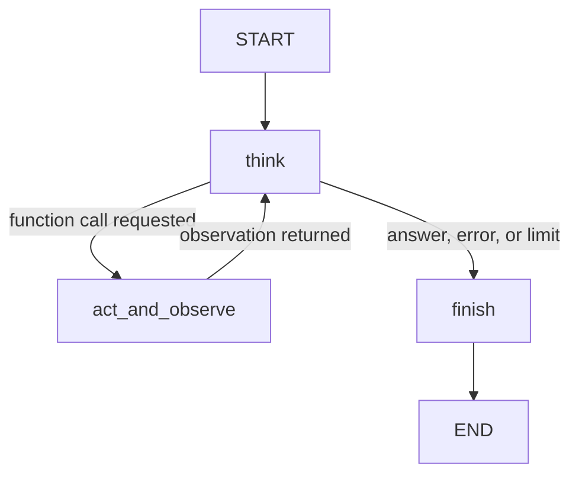

# Byte Club Studio

Ismail Abou Zeid

C4 extends the C3 chatbot with a manual ReAct loop in LangGraph. It uses the same business documents, router, tools, validation, and Gemini connection.

For Moodle, the complete deliverable is `react_agent.ipynb`. The notebook embeds all 54 trial records and the full reflection, installs its dependencies, and recreates its business and evidence files. The other files in this folder are supporting repository copies.

## Run

Open `react_agent.ipynb` in Colab, supply `GEMINI_API_KEY` through Secrets or hidden input, and run the cells in order. A CPU is sufficient. The notebook writes its business documents itself.

Locally, install `requirements.txt`, create a filled `.env` excluded from Git, and run `python app.py`. Model selection is configurable; the default is `gemini-3.5-flash-lite`.

## Manual ReAct loop

`think` makes one Gemini call, inspects tool requests, and parses visible final text. `act_and_observe` validates the name and arguments, invokes the declared Python function, and returns its observation to Gemini. `choose_next` determines whether to act or finish. The counter limits execution to five model calls. `finish` optionally performs a reflection pass.

All nodes, routing, execution, and final parsing are written in this project. No AgentExecutor, prebuilt ReAct executor, `create_react_agent`, or `ToolNode` is used. Framework dependencies may install prebuilt modules transitively; they are not imported by this application.

## Personas and settings

| Persona | Role and prompt traits | Temperature | Top-p | Top-k |
| --- | --- | --- | --- | --- |
| Sheriff | Welcoming intake concierge; plain language and light frontier humor | 0.40 | 0.85 | 32 |
| Patch | Precise technical scoping advisor; concise, explicit limits | 0.15 | 0.75 | 20 |
| Professor Pip | Learning advisor; simple examples, curious and encouraging | 0.70 | 0.95 | 40 |

All default to 2,048 maximum output tokens. Lower sampling settings are intended to support Patch's focused role; Pip's settings allow more varied explanations. These are design hypotheses, not proof of better performance. Common instructions override style where facts or actions are involved.

## Required experiments

The shared test set contains six cases: price/duration, PDF-only policies, a complete lead, explicit feedback, an unknown certification, and missing email. Each condition starts with empty history and its own synthetic log directory.

| Condition | Change from Patch baseline |
| --- | --- |
| Baseline | Patch preset; worked examples in system instructions; direct reply |
| Explained decision | Request a concise, checkable customer-facing explanation |
| Zero-shot ablation | Remove worked demonstrations for the comparison only |
| Instructions in message | Move the same operational instructions to the current user message |
| Temperature | Change only temperature to 0.80 |
| Top-p | Change only top-p to 0.95 |
| Top-k | Change only top-k to 40 |
| Sheriff preset | Change persona wording, role, and its associated settings |
| Pip preset | Change persona wording, role, and its associated settings |

The complete matrix contains 54 turns per repeat. Each turn may require more than one Gemini request. Each row saves the exact settings, input, reply, visible tool trace, model-step count, token count, elapsed time, and simple checks. The runner saves errors and stops so failures remain visible rather than being retried silently.

The explained-decision condition operationalizes the assignment's with/without Chain-of-Thought prompt comparison using a brief visible rationale. It does not expose private reasoning and does not establish that internal reasoning was absent in the direct condition. Production includes the required worked examples; the zero-shot condition is an explicitly labeled ablation.

Read the actual replies and `REFLECTION.md`. Automatic checks verify expected routes, tool use, completion, and selected factual terms. They cannot judge naturalness, full factual correctness, or reasoning quality by themselves. A one-repeat demonstration does not support statistical significance claims.

## Requirements and grading map

| Rubric | Points | Evidence |
| --- | --- | --- |
| Use-case summary and write-up | 10 | Notebook business section; audience, goals, tools, limits |
| Manual ReAct logic | 30 | `ReActState`, `build_react_graph`, nodes, conditional edges, `model_step`, `action_step` |
| Persona prompt and configuration | 20 | Three `PERSONAS`, role-specific prompts and parameter presets |
| Configuration experiments and comparison | 15 | `experiment_setups`, `run_experiments`, saved JSONL rows and reflection |
| Clear instructions | 10 | Focused `CORE_INSTRUCTIONS`, explicit inputs/outputs, worked examples |
| Creativity, clarity, reflection | 15 | Notebook narrative, business design, UI, evidence-based `REFLECTION.md` |

## Inherited limitations

The business and contact details are fictional. Tools write local demonstration records and never send email or confirm appointments. History is limited to six completed turns. API quota and model behavior can vary. The instruction-placement experiment weakens the separation between application rules and user content intentionally for comparison; the default keeps operational instructions in the system prompt.

## Final validation hardening

Lead tools reject names and emails absent from the actual customer messages, even when the model copies a worked example. The interface derives model history from the visible conversation and clears Gradio's internal states on persona changes. Saved comparison data predates this hardening; final regression evidence checks the updated implementation separately.
